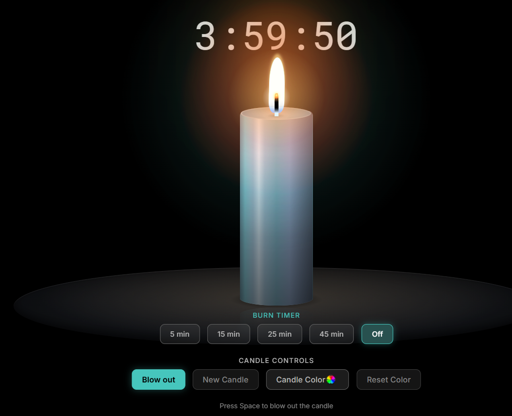

# 🕯️ Candle

A calm, realistic CSS candle that burns down in real time. Built with React and TypeScript as a learning project.

**🔗 Live demo:** https://alena0490.github.io/Candle/



## Features

- Realistic flame, glow, smoke and wax drips made with pure CSS
- The candle burns down over 4 hours and keeps burning while the page is closed
- Timer presets (5 / 15 / 25 / 45 min) that blow the candle out when time is up
- Custom candle color derived from a single base color (OKLCH)
- State saved in `localStorage`
- Keyboard shortcuts and screen reader announcements
- Respects `prefers-reduced-motion`

## Controls

| Action | Button | Key |
| --- | --- | --- |
| Light / blow out | Light / Blow out | `Space` |
| New candle (after burning out) | New Candle | `N` |
| Change color | Candle Color | — |
| Reset color | Reset Color | — |
| Set timer | 5 / 15 / 25 / 45 min | — |

## ⚙️ Tech stack

- React + TypeScript
- Vite
- CSS (custom properties, relative color syntax, `color-mix()`, `:has()`)
- GitHub Pages

## What I learned

- Managing state with `useReducer` and actions
- Side effects and cleanup with `useEffect` (timers, event listeners)
- Derived values instead of duplicated state
- Using `key` to remount components (smoke, wax drips)
- `useMemo` for one-time random values
- Passing values from React to CSS via custom properties
- Persisting and restoring state with `localStorage`

## Run locally

```bash
git clone https://github.com/Alena0490/Candle.git
cd Candle
npm install
npm run dev
```

## 💡 Inspiration

Inspired by a vibe-coded candle timer I saw in a video. Rebuilt from scratch to learn React.
